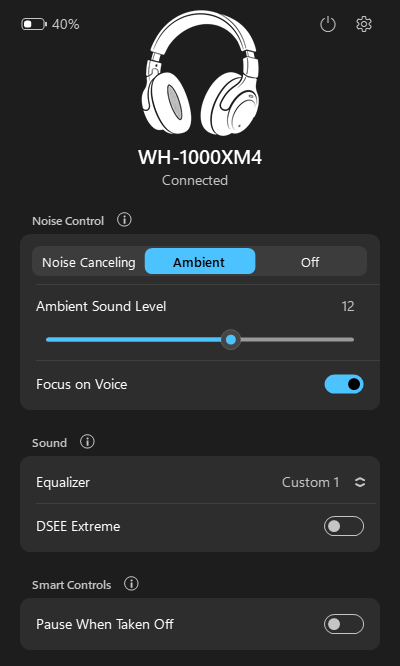
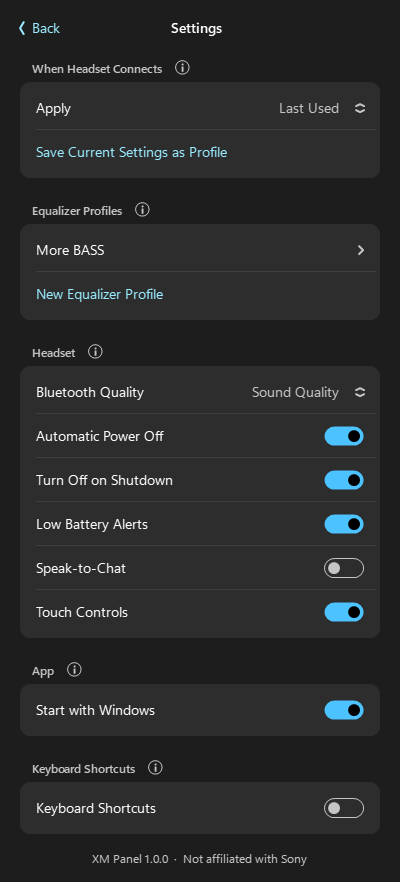
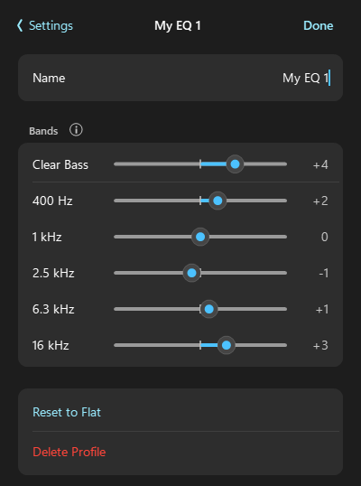

# XM Panel

A small Windows tray companion for Sony WH-1000X headphones: noise canceling, ambient sound, EQ, and the headset settings that are normally only in Sony's phone app, right from the taskbar.

  
  
  

## Features

- **Lives in the tray:** click the headphone icon to open a panel above the taskbar, like Windows quick settings. It follows light/dark mode and your Windows accent colour, with a translucent background on Windows 11.
- **Noise control:** switch between noise canceling, ambient sound (level 0–20, Focus on Voice) and off.
- **Equalizer:** use the built-in presets, or create your own profiles (Clear Bass plus 5 bands) and hear the changes live as you adjust them.
- **Restores your settings:** the headset always powers on in noise canceling or ambient sound. XM Panel switches it back to your last-used settings, or to a saved profile, each time it connects.
- **Headset settings:** DSEE Extreme, Speak-to-Chat, Pause When Taken Off, Touch Controls, Bluetooth quality (sound quality or stable connection) and Automatic Power Off.
- **Power:** turn the headset off from the panel or the tray menu. It can also turn the headset off automatically when Windows shuts down.
- **Extras:**
  - battery level in the panel and tray tooltip, with low-battery alerts
  - optional keyboard shortcuts (Ctrl+Alt+1/2/3/0)
  - start with Windows
- **Light on resources:** no measurable CPU use when idle and a few MB of memory. It doesn't keep searching over Bluetooth while the headset is off.

## Supported headsets

| Model | Status |
|---|---|
| WH-1000XM4 | Tested |
| WH-1000XM3 | Should work (same protocol as the XM4), untested |
| WH-1000XM5, WH-1000XM6 | Experimental and untested: uses the newer protocol, Pause When Taken Off is disabled |

If you try it on an untested model, please open an issue and include `%LOCALAPPDATA%\XMPanel\xmpanel.log`.

## Install

1. Pair the headset with Windows as usual (Settings → Bluetooth & devices).
2. Download `XMPanel.exe` from [Releases](../../releases) and run it. You can keep the file anywhere.
3. Windows SmartScreen may warn that the app is unrecognised, because it isn't code-signed. Choose **More info → Run anyway**.

Requires Windows 10 or 11. Nothing else needs to be installed: it uses .NET Framework 4.8, which comes with Windows.

### Build it yourself

Clone the repo and run `build.cmd`. It compiles `XMPanel.cs` with the C# compiler that ships with Windows and puts the app in `%LOCALAPPDATA%\XMPanel` with a Start Menu shortcut. No SDK or Visual Studio is needed.

## Privacy

The app talks only to your headset over Bluetooth, and never uses the internet. Settings are stored in `%LOCALAPPDATA%\XMPanel\settings.ini`.

## Uninstall

Turn off **Start with Windows** in Settings and quit from the tray menu. Then delete the exe and the `%LOCALAPPDATA%\XMPanel` folder, plus the "XM Panel" Start Menu shortcut if you built it yourself.

## How it works and credits

The app speaks Sony's headset control protocol over Bluetooth RFCOMM, the same channel the Sony phone app uses. Every command for the XM4 was checked against a real headset. These projects documented the protocol:

- [Gadgetbridge](https://codeberg.org/Freeyourgadget/Gadgetbridge), Sony headphones support (protocol reference)
- [SonyHeadphonesClient](https://github.com/Plutoberth/SonyHeadphonesClient) by Plutoberth
- [SonyCompanionApp](https://github.com/whitebeard10/SonyCompanionApp) by whitebeard10 (XM5/XM6 protocol details)

## Disclaimer

XM Panel is an independent project and is not affiliated with, endorsed by or supported by Sony. "Sony" and "WH-1000XM4" are trademarks of Sony Group Corporation. Use it at your own risk.

## License

[MIT](LICENSE)
